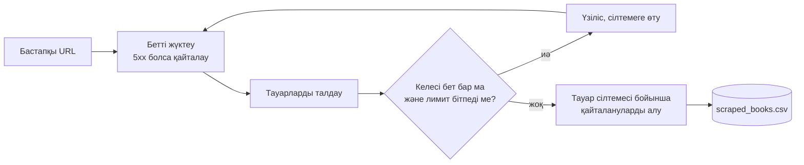

<div align="center">

# 🕷️ Website Scraper to CSV

**Беттерге бөлінген тауар каталогын көрсетіңіз, бір пәрменмен қайталануларсыз таза CSV алыңыз.**

[](https://github.com/artyom129/website-scraper-to-csv/actions/workflows/tests.yml)


**🌐 Тіл:** [English](README.md) · [Русский](README.ru.md) · **Қазақша**

</div>

---

## 📌 Не үшін қажет

Каталогтар мен анықтамалықтардан тауар деректерін қолмен көшіру ұзақ, ал нәтиже сирек біркелкі болады. Скрипт сол жұмысты бір пәрменмен орындайды және әр жолы бірдей бағандар береді, оларды бірден Excel-де ашуға немесе басқа жерге импорттауға болады. Демо [books.toscrape.com](https://books.toscrape.com/) сайтымен жұмыс істейді, ол парсингті жаттықтыру үшін жасалған, сондықтан біреудің ережесін бұзудан қорықпай-ақ байқап көруге болады.

## ✨ Не істейді

| | Мүмкіндік |
|---|---|
| 🔗 | Тізімнің кез келген бетінен бастап, беттер біткенше немесе лимитке жеткенше «келесі» сілтемесімен жүреді |
| 🧾 | Әр тауардың атауын, бағасын, қолда бар-жоғын, рейтингін және сілтемесін оқиды |
| 🧭 | Тауар сілтемесін ол табылған беттің мекенжайына қатысты құрастырады (төмендегі қателер туралы ескертпені қараңыз) |
| 🧹 | Беттер қиылысса да, әр сілтемеге бір жазба қалдырады |
| 🔁 | Күту уақыты асқанда, байланыс қатесінде және 5xx жауабында үзіліс уақытын ұзартып, сұрауды қайталайды. 404 қатесі қайталанбайды |
| 🛑 | Беттер сілтемелері шеңбер құрып қалса, өзі тоқтайды |
| 🐢 | Серверді жүктемеу үшін сұраулар арасында үзіліс жасайды (әдепкіде 1 секунд) |
| 📄 | UTF-8 пішімін BOM-мен жазады, сондықтан Excel `£` белгісін дұрыс көрсетеді |
| 💻 | Командалық жолдан іске қосылады және қате болса `1` кодын қайтарады, сондықтан кесте бойынша жұмыстарға жарайды |

## 🔄 Қалай жұмыс істейді



## 🚀 Жылдам бастау

```bash
python -m venv .venv
```

Ортаны іске қосыңыз:

```bash
# Windows
.venv\Scripts\activate

# macOS / Linux
source .venv/bin/activate
```

Тәуелділіктерді орнатып, іске қосыңыз:

```bash
pip install -r requirements.txt
python website_scraper_to_csv.py
```

Әдепкіде скрипт үш бетті аралап, `output/scraped_books.csv` файлын жасайды.

## 🛠️ Қолдану

```bash
python website_scraper_to_csv.py                       # 3 бет, әдепкі файл
python website_scraper_to_csv.py --max-pages 0         # барлық беттер
python website_scraper_to_csv.py --delay 2 -o books.csv
python website_scraper_to_csv.py --url https://books.toscrape.com/catalogue/page-5.html
python website_scraper_to_csv.py --help
```

| Параметр | Сипаттама | Әдепкі мәні |
|---|---|---|
| `--url` | Бастайтын бет | `https://books.toscrape.com/` |
| `--max-pages` | Қанша бетті аралау керек, `0` шектеусіз | `3` |
| `--delay` | Сұраулар арасындағы үзіліс (секунд) | `1` |
| `-o`, `--output` | Жасалатын CSV файлы | `output/scraped_books.csv` |

> Сәтті болса шығу коды `0`, бетті жүктеу мүмкін болмаса `1`.

## 📊 Іске қосу мысалы

`--max-pages 2` үшін консольдағы шығыс:

```text
Scraping page 1: https://books.toscrape.com/
Scraping page 2: https://books.toscrape.com/catalogue/page-2.html
Done. Scraped records: 40
CSV file created: output/scraped_books.csv
```

Алынған файлдың алғашқы жолдары (тікелей іске қосудың нақты нәтижесі):

| title | price | availability | rating | product_url |
|---|---|---|---|---|
| A Light in the Attic | £51.77 | In stock | Three | https://books.toscrape.com/catalogue/a-light-in-the-attic_1000/index.html |
| Tipping the Velvet | £53.74 | In stock | One | https://books.toscrape.com/catalogue/tipping-the-velvet_999/index.html |
| Soumission | £50.10 | In stock | One | https://books.toscrape.com/catalogue/soumission_998/index.html |

## 🧩 CSV бағандары

| Баған | Қайдан алынады |
|---|---|
| `title` | `h3` ішіндегі сілтеменің `title` атрибуты |
| `price` | `.price_color` |
| `availability` | `.availability`, артық бос орындар алынған |
| `rating` | `.star-rating` класындағы рейтинг сөзі (`One`-нан `Five`-қа дейін) |
| `product_url` | сол сілтеменің `href` мәні, толық URL-ға айналдырылған |

## 🔧 Басқа сайтқа бейімдеу

Сайтқа тәуелді барлық код `parse_books_from_page` және `find_next_page_url` функцияларында. Басқа каталогты жинау үшін CSS селекторларын және `Book` датакласының өрістерін ауыстырыңыз:

```python
for article in soup.select("article.product_pod"):      # тауардың бір картасы
    title_element = article.select_one("h3 a")          # атауы және сілтемесі
    price_element = article.select_one(".price_color")   # бағасы
...
next_link = soup.select_one("li.next a")                 # беттер арасында жүру
```

Сұрауларды қайталау, сілтемелерді құру, шеңберден қорғау, қайталануларды алып тастау және CSV-ға экспорт кез келген сайтта өзгеріссіз жұмыс істейді. Парсингтен бұрын сайттың пайдалану шарттары мен robots.txt файлын тексеріңіз.

Әдеттегі қолданыстар: бизнес-анықтамалықтар, жылжымайтын мүлік хабарландырулары, интернет-дүкен каталогтарын зерттеу, тауардың бар-жоғын бақылау.

<details>
<summary>🐛 Жасау кезінде табылып, түзетілген мәселелер</summary>

<br>

- **Бірінші беттен кейінгі бұзылған сілтемелер.** Бұл каталогта бірінші беттегі сілтемелер `catalogue/book_1/index.html` түрінде, ал екінші беттен бастап `book_2/index.html` түрінде, яғни `/catalogue/` қалтасына қатысты жазылған. Әр сілтемені сайттың түбіріне жалғасақ, жоқ мекенжайлар шығады. Енді сілтеме ол табылған беттің мекенжайына жалғанады.
- **`£` орнына `£`.** Сервер кодтауды хабарламайды, `response.text` оны ISO-8859-1 деп болжады. Енді скрипт BeautifulSoup-қа шикі байттарды береді, ол кодтауды беттің өзінен оқиды.
- **Excel және UTF-8.** Файл BOM-мен басталмаса, Excel UTF-8 CSV-ны ANSI ретінде ашады, сондықтан экспорт кезінде BOM қосылады.
- **Шексіз аралау.** Сайттағы «келесі» сілтемесі бұрын өтілген бетке апарса, скрипт мәңгі жұмыс істер еді. Өтілген мекенжайлар есте сақталады, алғашқы қайталануда аралау тоқтайды.

</details>

## 🧪 Тесттер

```bash
python -m pytest -q
```

18 тест желісіз жұмыс істейді. Олар беттерді талдауды, кейінгі беттердегі сілтемелерді құруды, беттерді аралау мен лимитті, шеңберден қорғауды, қайталануларды алып тастауды, сұрауларды қайталауды, кодтауды, CSV файлын және командалық жолды тексереді. CI оларды Python 3.11 және 3.12 нұсқаларында іске қосады.

## 📂 Жоба құрылымы

```text
.
├── website_scraper_to_csv.py     # жүктеу, талдау, аралау, экспорт, CLI
├── tests/test_scraper.py
├── requirements.txt
└── .github/workflows/tests.yml   # CI: Python 3.11 және 3.12
```

## 🧰 Технологиялар

Python · Requests · BeautifulSoup · pytest · GitHub Actions

---

<div align="center">

*Жеке демонстрациялық жоба: беттерге бөлінген каталогты аралау, құрылымдалған деректерді алу, қайталануларды өңдеу және CSV-ға шығаруды автоматтандыру.*

</div>
