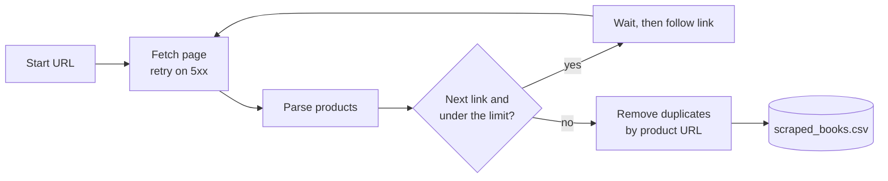

<div align="center">

# 🕷️ Website Scraper to CSV

**Point it at a paginated product catalog and get a clean, deduplicated CSV in one command.**

[](https://github.com/artyom129/website-scraper-to-csv/actions/workflows/tests.yml)


**🌐 Language:** **English** · [Русский](README.ru.md) · [Қазақша](README.kk.md)

</div>

---

## 📌 Why this exists

Copying product data out of catalogs and directories by hand is slow, and the result is rarely consistent. This script does the same job in one command and produces the same columns every time, ready to open in Excel or import elsewhere. The demo runs against [books.toscrape.com](https://books.toscrape.com/), a site built for scraping practice, so you can try it without worrying about anyone's terms of service.

## ✨ What it does

| | Feature |
|---|---|
| 🔗 | Starts from any listing page and follows the "next" link until the pages run out or a page limit is reached |
| 🧾 | Reads title, price, availability, rating, and product URL for every item |
| 🧭 | Resolves each product link against the page it was found on (see the bug notes below) |
| 🧹 | Keeps one record per product URL, even when pages overlap |
| 🔁 | Retries timeouts, connection errors, and 5xx responses with a growing pause. A 404 is not retried |
| 🛑 | Stops by itself if the pagination links form a loop |
| 🐢 | Waits between requests so it does not hammer the server (1 second by default) |
| 📄 | Writes UTF-8 with a byte order mark, so Excel shows the `£` sign correctly |
| 💻 | Runs from the command line and returns exit code `1` on failure, so it fits into scheduled jobs |

## 🔄 How it works



## 🚀 Quick start

```bash
python -m venv .venv
```

Activate the environment:

```bash
# Windows
.venv\Scripts\activate

# macOS / Linux
source .venv/bin/activate
```

Install the dependencies and run:

```bash
pip install -r requirements.txt
python website_scraper_to_csv.py
```

By default it scrapes three pages and writes `output/scraped_books.csv`.

## 🛠️ Usage

```bash
python website_scraper_to_csv.py                       # 3 pages, default file
python website_scraper_to_csv.py --max-pages 0         # every page
python website_scraper_to_csv.py --delay 2 -o books.csv
python website_scraper_to_csv.py --url https://books.toscrape.com/catalogue/page-5.html
python website_scraper_to_csv.py --help
```

| Option | Description | Default |
|---|---|---|
| `--url` | Page to start from | `https://books.toscrape.com/` |
| `--max-pages` | Number of pages to scrape, `0` for no limit | `3` |
| `--delay` | Seconds to wait between requests | `1` |
| `-o`, `--output` | CSV file to create | `output/scraped_books.csv` |

> The exit code is `0` on success and `1` if a page cannot be downloaded.

## 📊 Example run

Console output for `--max-pages 2`:

```text
Scraping page 1: https://books.toscrape.com/
Scraping page 2: https://books.toscrape.com/catalogue/page-2.html
Done. Scraped records: 40
CSV file created: output/scraped_books.csv
```

First rows of the resulting file (real output from a live run):

| title | price | availability | rating | product_url |
|---|---|---|---|---|
| A Light in the Attic | £51.77 | In stock | Three | https://books.toscrape.com/catalogue/a-light-in-the-attic_1000/index.html |
| Tipping the Velvet | £53.74 | In stock | One | https://books.toscrape.com/catalogue/tipping-the-velvet_999/index.html |
| Soumission | £50.10 | In stock | One | https://books.toscrape.com/catalogue/soumission_998/index.html |

## 🧩 Output columns

| Column | Where it comes from |
|---|---|
| `title` | the `title` attribute of the link inside `h3` |
| `price` | `.price_color` |
| `availability` | `.availability`, whitespace collapsed |
| `rating` | the rating word in the `.star-rating` class (`One` to `Five`) |
| `product_url` | the `href` of the same link, resolved to a full URL |

## 🔧 Adapting it to another site

All site-specific code is in `parse_books_from_page` and `find_next_page_url`. To scrape a different catalog, change the CSS selectors and the fields of the `Book` dataclass:

```python
for article in soup.select("article.product_pod"):      # one card per product
    title_element = article.select_one("h3 a")          # title and link
    price_element = article.select_one(".price_color")   # price
...
next_link = soup.select_one("li.next a")                 # pagination
```

Retries, link resolution, loop protection, deduplication, and CSV export work on any site without changes. Check the site's terms of use and robots.txt before you scrape it.

Typical uses: business directories, real estate listings, e-commerce catalog research, and product availability tracking.

<details>
<summary>🐛 Problems found and fixed while building this</summary>

<br>

- **Broken links after page 1.** On this catalog, page 1 links look like `catalogue/book_1/index.html`, but page 2 and later use `book_2/index.html`, relative to `/catalogue/`. Joining every link to the site root produced URLs that do not exist. Links are now joined to the URL of the page they were found on.
- **`£` instead of `£`.** The server sends no charset, so `response.text` guessed ISO-8859-1. The scraper now hands the raw bytes to BeautifulSoup, which reads the charset from the page.
- **Excel and UTF-8.** Excel opens a UTF-8 CSV as ANSI unless the file starts with a BOM, so the export adds one.
- **Endless crawls.** A site whose "next" link points back to an earlier page would keep the scraper running forever. Visited URLs are remembered and the crawl stops on the first repeat.

</details>

## 🧪 Tests

```bash
python -m pytest -q
```

18 tests run without a network. They cover parsing, link resolution on later pages, pagination and the page limit, loop protection, deduplication, retries, charset handling, the CSV file, and the command line. CI runs them on Python 3.11 and 3.12.

## 📂 Project layout

```text
.
├── website_scraper_to_csv.py     # fetching, parsing, crawling, export, CLI
├── tests/test_scraper.py
├── requirements.txt
└── .github/workflows/tests.yml   # CI on Python 3.11 and 3.12
```

## 🧰 Tech stack

Python · Requests · BeautifulSoup · pytest · GitHub Actions

---

<div align="center">

*A personal demonstration project for pagination, structured extraction, duplicate handling, and CSV automation.*

</div>
