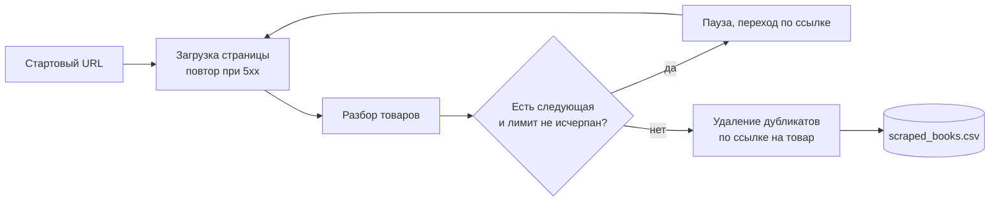

<div align="center">

# 🕷️ Website Scraper to CSV

**Укажите каталог товаров с постраничной навигацией и получите чистый CSV без дубликатов одной командой.**

[](https://github.com/artyom129/website-scraper-to-csv/actions/workflows/tests.yml)


**🌐 Язык:** [English](README.md) · **Русский** · [Қазақша](README.kk.md)

</div>

---

## 📌 Зачем это нужно

Переносить данные о товарах из каталогов и справочников вручную долго, и результат получается неоднородным. Скрипт делает то же самое одной командой и каждый раз выдаёт одинаковые колонки, которые можно сразу открыть в Excel или импортировать дальше. Демо работает с [books.toscrape.com](https://books.toscrape.com/), сайтом для тренировки парсинга, поэтому попробовать его можно, не опасаясь нарушить чьи-то правила.

## ✨ Что он делает

| | Возможность |
|---|---|
| 🔗 | Начинает с любой страницы списка и идёт по ссылке «следующая», пока страницы не кончатся или не будет достигнут лимит |
| 🧾 | Читает название, цену, наличие, рейтинг и ссылку на каждый товар |
| 🧭 | Строит ссылку на товар относительно страницы, на которой она найдена (см. заметки об ошибках ниже) |
| 🧹 | Оставляет одну запись на ссылку, даже если страницы пересекаются |
| 🔁 | Повторяет запрос при таймауте, ошибке соединения и ответе 5xx, увеличивая паузу. Ошибка 404 не повторяется |
| 🛑 | Сам останавливается, если ссылки пагинации замкнулись в цикл |
| 🐢 | Делает паузу между запросами, чтобы не нагружать сервер (по умолчанию 1 секунда) |
| 📄 | Пишет UTF-8 с BOM, поэтому Excel правильно показывает знак `£` |
| 💻 | Запускается из командной строки и возвращает код `1` при ошибке, поэтому подходит для заданий по расписанию |

## 🔄 Как это работает



## 🚀 Быстрый старт

```bash
python -m venv .venv
```

Активируйте окружение:

```bash
# Windows
.venv\Scripts\activate

# macOS / Linux
source .venv/bin/activate
```

Установите зависимости и запустите:

```bash
pip install -r requirements.txt
python website_scraper_to_csv.py
```

По умолчанию скрипт обходит три страницы и создаёт `output/scraped_books.csv`.

## 🛠️ Использование

```bash
python website_scraper_to_csv.py                       # 3 страницы, файл по умолчанию
python website_scraper_to_csv.py --max-pages 0         # все страницы
python website_scraper_to_csv.py --delay 2 -o books.csv
python website_scraper_to_csv.py --url https://books.toscrape.com/catalogue/page-5.html
python website_scraper_to_csv.py --help
```

| Параметр | Описание | По умолчанию |
|---|---|---|
| `--url` | Страница, с которой начать | `https://books.toscrape.com/` |
| `--max-pages` | Сколько страниц обойти, `0` без ограничения | `3` |
| `--delay` | Пауза между запросами в секундах | `1` |
| `-o`, `--output` | CSV-файл, который будет создан | `output/scraped_books.csv` |

> Код выхода `0` при успехе и `1`, если страницу не удалось скачать.

## 📊 Пример запуска

Вывод в консоли для `--max-pages 2`:

```text
Scraping page 1: https://books.toscrape.com/
Scraping page 2: https://books.toscrape.com/catalogue/page-2.html
Done. Scraped records: 40
CSV file created: output/scraped_books.csv
```

Первые строки получившегося файла (настоящий результат живого запуска):

| title | price | availability | rating | product_url |
|---|---|---|---|---|
| A Light in the Attic | £51.77 | In stock | Three | https://books.toscrape.com/catalogue/a-light-in-the-attic_1000/index.html |
| Tipping the Velvet | £53.74 | In stock | One | https://books.toscrape.com/catalogue/tipping-the-velvet_999/index.html |
| Soumission | £50.10 | In stock | One | https://books.toscrape.com/catalogue/soumission_998/index.html |

## 🧩 Колонки в CSV

| Колонка | Откуда берётся |
|---|---|
| `title` | атрибут `title` ссылки внутри `h3` |
| `price` | `.price_color` |
| `availability` | `.availability`, лишние пробелы убраны |
| `rating` | слово рейтинга в классе `.star-rating` (от `One` до `Five`) |
| `product_url` | `href` той же ссылки, превращённый в полный URL |

## 🔧 Как адаптировать под другой сайт

Весь код, зависящий от сайта, находится в `parse_books_from_page` и `find_next_page_url`. Чтобы собирать другой каталог, поменяйте CSS-селекторы и поля датакласса `Book`:

```python
for article in soup.select("article.product_pod"):      # одна карточка товара
    title_element = article.select_one("h3 a")          # название и ссылка
    price_element = article.select_one(".price_color")   # цена
...
next_link = soup.select_one("li.next a")                 # пагинация
```

Повторы запросов, построение ссылок, защита от циклов, удаление дубликатов и экспорт в CSV работают на любом сайте без изменений. Перед парсингом проверьте условия использования сайта и его robots.txt.

Типичные применения: бизнес-справочники, объявления о недвижимости, исследование каталогов интернет-магазинов, отслеживание наличия товаров.

<details>
<summary>🐛 Проблемы, найденные и исправленные при разработке</summary>

<br>

- **Битые ссылки после первой страницы.** В этом каталоге на первой странице ссылки выглядят как `catalogue/book_1/index.html`, а начиная со второй как `book_2/index.html`, то есть относительно `/catalogue/`. Если приклеивать каждую ссылку к корню сайта, получаются несуществующие адреса. Теперь ссылка строится от адреса страницы, на которой она найдена.
- **`£` вместо `£`.** Сервер не сообщает кодировку, и `response.text` угадывал ISO-8859-1. Теперь скрипт передаёт BeautifulSoup сырые байты, и тот читает кодировку из самой страницы.
- **Excel и UTF-8.** Excel открывает UTF-8 CSV как ANSI, если файл не начинается с BOM, поэтому при экспорте он добавляется.
- **Бесконечный обход.** Если ссылка «следующая» на сайте ведёт на уже пройденную страницу, скрипт крутился бы вечно. Посещённые адреса запоминаются, и обход останавливается при первом повторе.

</details>

## 🧪 Тесты

```bash
python -m pytest -q
```

18 тестов работают без сети. Они проверяют разбор страницы, построение ссылок на поздних страницах, пагинацию и лимит страниц, защиту от циклов, удаление дубликатов, повторы запросов, кодировку, CSV-файл и командную строку. CI запускает их на Python 3.11 и 3.12.

## 📂 Структура проекта

```text
.
├── website_scraper_to_csv.py     # загрузка, разбор, обход, экспорт, CLI
├── tests/test_scraper.py
├── requirements.txt
└── .github/workflows/tests.yml   # CI на Python 3.11 и 3.12
```

## 🧰 Технологии

Python · Requests · BeautifulSoup · pytest · GitHub Actions

---

<div align="center">

*Личный демонстрационный проект: пагинация, извлечение структурированных данных, удаление дубликатов и автоматизация выгрузки в CSV.*

</div>
